# Flujos del sistema

Diagramas de negocio del template **Angular + Go**. Muestran actores, operaciones,
decisiones y casos límite; no componentes de Angular ni nombres de clases.

Los diagramas interactivos viven en `front/public/flujos/` y se sirven con la SPA.
Se abren desde el sidebar en **Flujos** (`/dashboard/flujos`) o directo en
`/template/flujos/index.html`.

## Índice

| Flujo | Qué responde | Tipo | HTML | PNG | Documento fuente |
| --- | --- | --- | --- | --- | --- |
| Acceso y restauración de sesión | ¿Cómo entra un usuario y cómo sobrevive la sesión? | Secuencia | [login.html](../../front/public/flujos/login.html) | [login.png](img/login.png) | [login.md](../flujos/login.md) |
| Cierre de sesión y revocación | ¿Qué pasa al salir y al revocar permisos? | Flujo | [logout.html](../../front/public/flujos/logout.html) | [logout.png](img/logout.png) | [logout.md](../flujos/logout.md) |
| Vida del contador de sesión | ¿Cómo cuenta la sesión y cuándo se cierra sola? | Ciclo de vida | [sesion-contador.html](../../front/public/flujos/sesion-contador.html) | [sesion-contador.png](img/sesion-contador.png) | [sesion-contador.md](../flujos/sesion-contador.md) |
| Usuarios, permisos y JWT | ¿Cómo se asignan permisos y cómo llegan al token? | Flujo | [usuarios-permisos.html](../../front/public/flujos/usuarios-permisos.html) | [usuarios-permisos.png](img/usuarios-permisos.png) | [usuarios-permisos.md](../flujos/usuarios-permisos.md) |
| Mensajes en vivo con SSE | ¿Cómo llega un cambio a todos los dashboards? | Secuencia | [mensajes-sse.html](../../front/public/flujos/mensajes-sse.html) | [mensajes-sse.png](img/mensajes-sse.png) | [mensajes-sse.md](../flujos/mensajes-sse.md) |
| Archivos e imágenes: público y privado | ¿Dónde vive cada archivo y quién lo sirve? | Datos | [archivos.html](../../front/public/flujos/archivos.html) | [archivos.png](img/archivos.png) | [archivos.md](../flujos/archivos.md) |
| Buses: listar, filtrar y mantener | ¿Cómo funciona el CRUD paginado de buses? | Flujo | [buses.html](../../front/public/flujos/buses.html) | [buses.png](img/buses.png) | [buses.md](../flujos/buses.md) |
| Tienda: categorías, productos e imágenes | ¿Cómo se relacionan categorías, productos e imágenes? | Flujo | [tienda.html](../../front/public/flujos/tienda.html) | [tienda.png](img/tienda.png) | [tienda.md](../flujos/tienda.md) |
| Reportes y documentos | ¿Cómo se genera un reporte en PDF o Excel? | Flujo | [reportes.html](../../front/public/flujos/reportes.html) | [reportes.png](img/reportes.png) | [reportes.md](../flujos/reportes.md) |
| Vida de un documento generado | ¿Qué estados y versiones tiene un documento? | Ciclo de vida | [documentos.html](../../front/public/flujos/documentos.html) | [documentos.png](img/documentos.png) | [reportes.md](../flujos/reportes.md) |
| Instalaciones en el mapa | ¿Cómo se gestionan instalaciones desde el mapa? | Flujo | [instalaciones-mapas.html](../../front/public/flujos/instalaciones-mapas.html) | [instalaciones-mapas.png](img/instalaciones-mapas.png) | [instalaciones-mapas.md](../flujos/instalaciones-mapas.md) |

> **Pendiente de actualización:** el HTML, PNG y GIF de **Mensajes en vivo con
> SSE** todavía muestran el flujo anterior (conexión directa a
> `/mensajes_pendientes/events`). El flujo vigente es un único `GET /sse/events`
> filtrado por permisos; ver [mensajes-sse.md](../flujos/mensajes-sse.md). Hay
> que regenerar el diagrama y sus capturas.

## Demostraciones animadas

Cinco flujos del núcleo tienen una grabación del movimiento del diagrama:

### Acceso y restauración de sesión

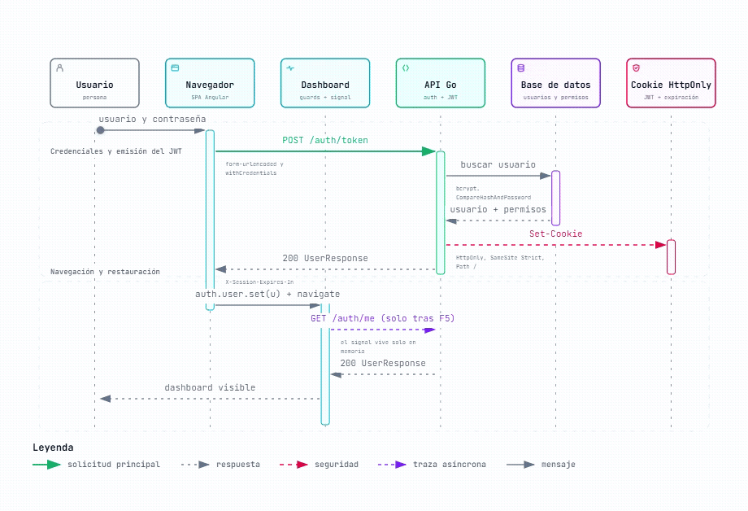

### Vida del contador de sesión

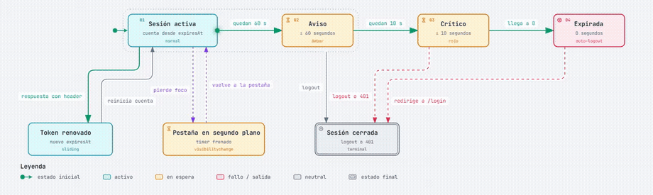

### Mensajes en vivo con SSE

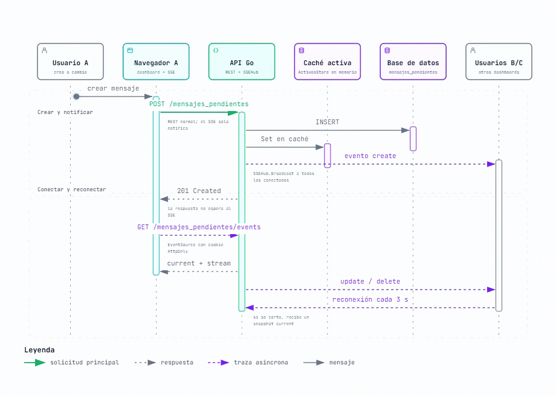

### Archivos e imágenes: público y privado

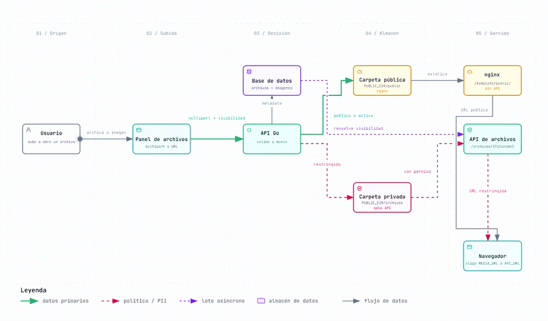

### Reportes y documentos

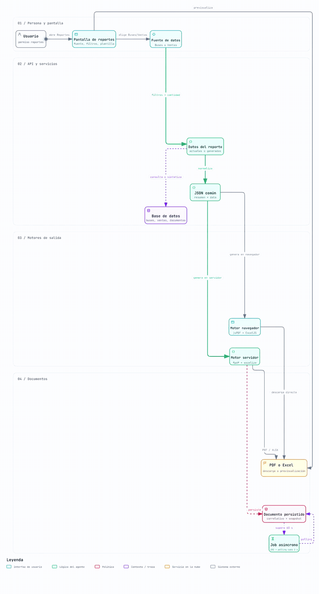

## Capturas del resto de flujos

### Cierre de sesión y revocación

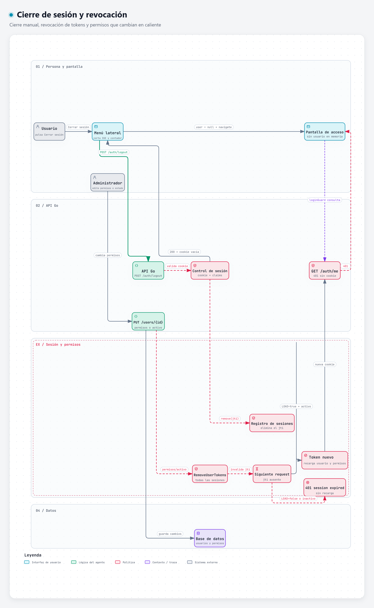

### Usuarios, permisos y JWT

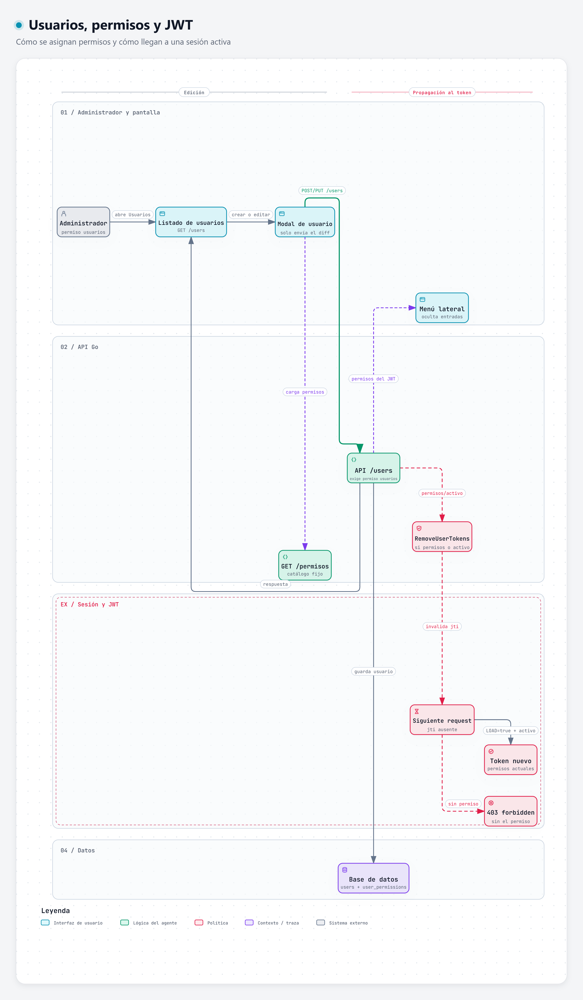

### Buses: listar, filtrar y mantener

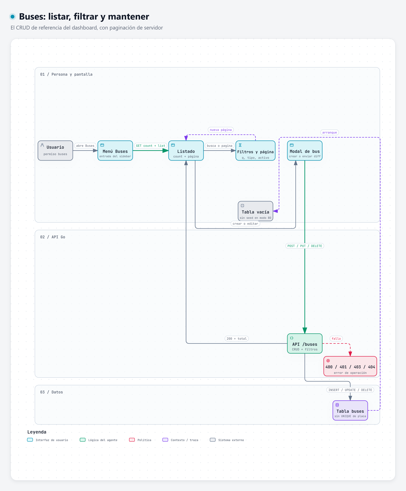

### Tienda: categorías, productos e imágenes

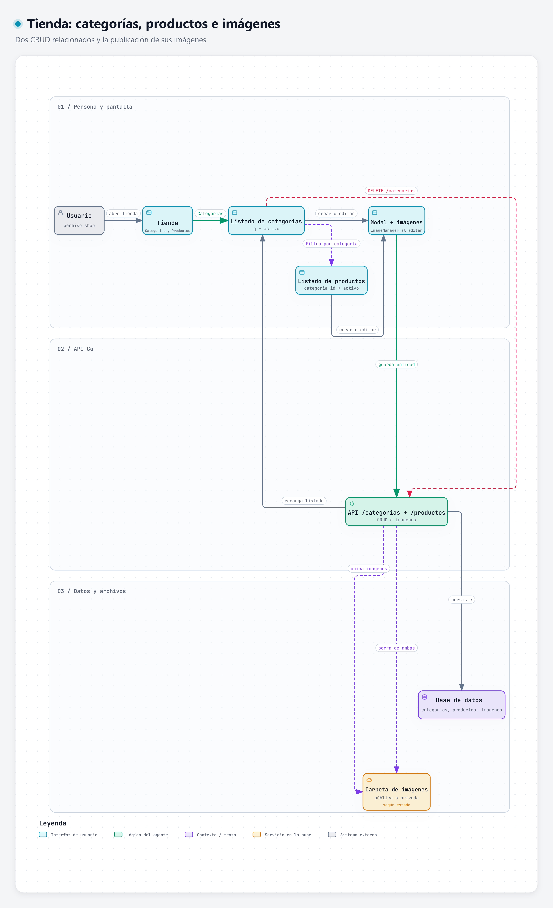

### Vida de un documento generado

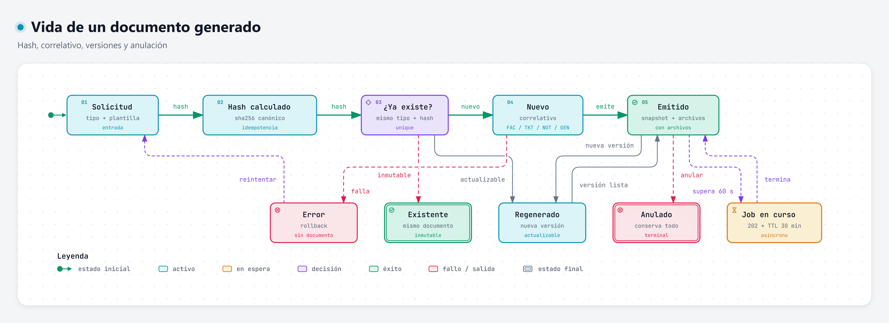

### Instalaciones en el mapa

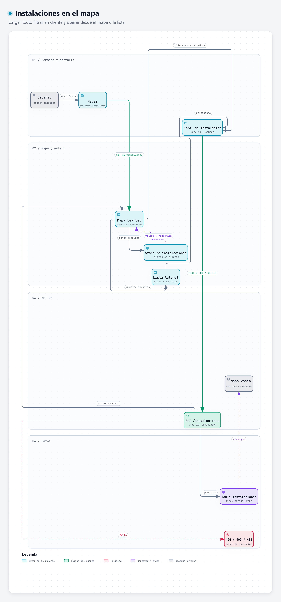

## Cómo se abren

- **En la aplicación:** inicia sesión y entra a **Flujos** en el sidebar.
- **Directo, sin Angular:** `/template/flujos/index.html` o
  `/template/flujos/<flujo>.html`.
- **Desarrollo:** `ng serve` sirve los archivos en `/flujos/index.html`.
- **Producción:** `ng build --base-href=/template/` copia `public/flujos/` dentro
  del build; nginx los sirve bajo `/template/flujos/`.

Cada HTML es autónomo: incluye el visor, el modo claro/oscuro, Live/Still, zoom
y exportación a PNG, SVG, JPEG, WebP y WebM.

> Los HTML están en `front/public/`, por lo que quedan accesibles sin login por
> URL directa, aunque el sidebar requiera sesión. Si en el futuro se quieren
> proteger, conviene servirlos desde Go con `AuthMiddleware()`.

## Cómo regenerar

Los JSON de Archify están en [`fuentes/`](fuentes/). Cada uno declara su salida
en `front/public/flujos/<flujo>.html`.

```powershell
cd C:\Users\USUARIO\Desktop\Andriw\PROYECTOS\Templates\angular-go-template
$archify = "C:\Users\USUARIO\Desktop\Andriw\HERRAMIENTAS_IA\crear_diagramas\.agents\skills\archify\bin\archify.mjs"

node $archify finalize sequence "docs/diagramas/fuentes/login.json" `
  "front/public/flujos/login.html" --repo-root . --quality showcase --json
```

Para las capturas, abre el HTML, usa **Exportar → PNG** y guarda en `img/`.
Para los GIF, exporta **WebM** y conviértelo con `ffmpeg`:

```powershell
ffmpeg -y -i docs\diagramas\img\anim\login.webm `
  -vf "fps=12,scale=920:-1:flags=lanczos,split[s0][s1];[s0]palettegen=max_colors=128[p];[s1][p]paletteuse=dither=bayer" `
  -loop 0 docs\diagramas\img\login.gif
```

## Evidencia

- Repositorio: `https://github.com/Andriw75/angular-go-template`
- Revisión: `db02384130585abab33e03fed6a4e89cb46b9cfa`
- Fuente funcional: [`docs/flujos/`](../flujos/)
- Los nodos principales de cada diagrama citan rutas y líneas del código en los
  JSON de `fuentes/`.

## Notas de alcance

- Se excluyeron los diagramas de arquitectura/componentes y los ERD: el foco es
  el flujo de negocio y las operaciones.
- Los nombres de clases, componentes y handlers no aparecen en el lienzo; se
  conservan endpoints, headers, tablas y variables cuando aportan significado.
- Los GIF son una muestra de cinco flujos; los otros seis quedan como PNG.
